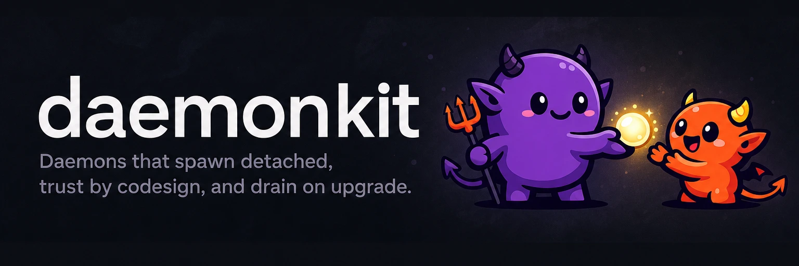

# 

**Daemons that spawn detached, own their children, and drain on upgrade.** daemonkit is the daemon + signed-app pattern extracted from fusekit, claude-pool, cc-interact, and synckit, shipped as one Go module and one Swift package. The Go runtime supports macOS and Linux on amd64 and arm64. Linux uses a foreground supervisor in place of launchd; `deploy`, `launchd`, and the Swift package are macOS-only.

[](https://github.com/yasyf/daemonkit/actions/workflows/ci.yml)
[](https://github.com/yasyf/daemonkit/blob/main/LICENSE)

## Get started

```bash
go get github.com/yasyf/daemonkit@latest
```

```text
go: added github.com/yasyf/daemonkit v<version>
```

<details>
<summary>Swift (SPM)</summary>

Add the package to your dependencies and link the `DaemonKit` library product into your app or helper target:

```swift
.package(url: "https://github.com/yasyf/daemonkit", exact: "0.20.10"),
```

</details>

Driving with an agent? Paste this:

```text
Add github.com/yasyf/daemonkit to my Go module (go get github.com/yasyf/daemonkit@latest),
check the package table in its README for what has landed, and replace this repo's
hand-rolled daemon process ownership (spawn, exclusive socket, drain, stop control) with
daemonkit's primitives.
```

---

## Use cases

### Hold a resource through `kill -9`

A daemon that owns kernel state — a FUSE mount, a keychain session — can't ride its parent's lifetime. Spawn it detached (new session, closed fds, a flock held for the listener's life) and the resource survives the CLI, the terminal, and the login session that started it. fusekit's mount holder has run this way in production since day one; `proc` is that machinery, extracted.

### Retire the old daemon when a new version ships

`Client.Ensure` compares the build the running daemon reports with the version
its `Program` names. A daemon already serving that build is the whole
answer, and launchd is not asked about it. Otherwise, Ensure drains the
incumbent, pinned to the build and generation it read, so a replacement
that raced in is refused instead of stopped, and watches that exact process
leave the process table. Then it applies the LaunchAgent and waits on the new
daemon's phase stream until it reports ready. A daemon that speaks another wire
protocol gets SIGTERM at the identity its owner record names.

### Let any of the user's processes connect

The socket lives in the user's 0700 state directory, and that directory is the
whole boundary. Any process that can open the socket is trusted. daemonkit
checks no code signature, team ID, entitlement, or user ID on a connecting process
or a spawned child. A client's health reads, drains, and first business call
share one connection, so a command that ensures the daemon and then calls it
opens the socket once.

### Call the daemon from a Swift app

`ServiceSocketClient` is a persistent unary client pinned to one schema. It
dials lazily, waits through daemon startup and takeover for a ready session,
and replays a call only when the transport proved it never dispatched.
`acquireReadyRuntime` returns once a ready session exists.

## The packages

Each row below is read out of the tree by `scripts/gen-package-table.sh` — the
package's own godoc summary and its file and line counts. CI regenerates the
table and fails the build when it drifts from disk, so a package that ships or
disappears cannot leave a stale row behind.

<!-- BEGIN GENERATED: package table (scripts/gen-package-table.sh) -->
| Package | Owns | Files | Lines |
|---|---|---|---|
| `artifact` | resolves a version-exact executable from a declarative descriptor, for the cc-family's one central "give me the binary that matches my version" primitive. | 17 | 3412 |
| `bundle` | reads a macOS .app's Info.plist and resolves the stable bundle paths a daemon installs to. | 5 | 208 |
| `deploy` | owns sealed installation, activation, supersession, and removal of one fixed signed application. | 17 | 7623 |
| `durable` | makes filesystem state survive crashes: atomic, fsynced publication of files and directory mutations, a strict validated JSON codec, and one bounded cross-process lock. | 11 | 1433 |
| `ghrelease` | queries GitHub for a repository's latest published release. | 2 | 170 |
| `launchd` | is the value-type model for one exact macOS user LaunchAgent and the stateless primitives that apply it. | 12 | 2996 |
| `paths` | owns the canonical state-directory layout under the user's home directory, resolved through the passwd database — never the caller's HOME or CLAUDE_CONFIG_DIR — so a sandboxed environment cannot relocate state. | 4 | 278 |
| `supervise` | is the service layer for a linux host with no init system to register with: the value-type model for one exact supervised service and the foreground supervisor that runs it. | 5 | 1709 |
| `templates` | — | 2 | 218 |
| `version` | classifies and compares release and development builds for launcher-owned runtime settlement and release ordering. | 2 | 302 |
<!-- END GENERATED: package table -->

Packages under `internal/` are module-private machinery and carry no compatibility
promise; they are left out of the table on purpose.

The Swift half lives in `Sources/DaemonKit`: generation-aware service clients,
the broker socket bridge, signed-process App Group resolution, `SMAppService`
login items, and snapshot watching.

The LaunchAgents `service` writes use no socket activation — the daemon binds and flocks its own socket (`proc`); launchd only keeps the process alive. Every `Agent` and `AppKeepAlive` selects `RestartAlways`, `RestartOnFailure`, or `NoRestart`; the policy is rendered directly into the launchd plist. On the Swift side, `DaemonKit` reconciles `SMAppService` login items (opening the Login Items settings pane when the item needs approval), watches snapshot directories, and rides the signed `.app` bundle for a stable bundle + TCC identity.

`BrokerSocketBridge` owns an App Group listener and takes a lifecycle
`RuntimeClientConfiguration`. The lifecycle session waits for a ready daemon; a
separate persistent session sends only `daemon.broker-handoff.v1`, carrying each
accepted descriptor to the daemon.

`deploy` never downloads an application. Packaging supplies one exact local
signed `.app`: a `Candidate` names it by source path, exact version, and
bundle-tree digest, and its bytes are copied into a private slot beside the
canonical path, never moved from under the caller. `deploy.Open` binds a
`Config` — the canonical `.app` path, the
`deploy.Requirement{TeamID, SigningIdentifier}` every generation's signature
must satisfy, the daemon, and the exact LaunchAgent set — into a `Deployment`, one application's
sealed lifecycle. Every generation passes `codesign` verification against that requirement before
it lands. `Install` lands the first generation and refuses an occupied
canonical path; `Supersede` proves the incumbent gone and its executables
empty, then swaps as one recorded rename pair, so a crash anywhere in the
middle resumes to the same end. `Activate` converges launchd to the agent set
and seals what the started daemon proves about itself; `Uninstall` quiesces,
converges the services away, and removes the app whole-to-absent in one rename;
`Reset` is the way out of a state no other verb accepts. Consumers never touch
the private stage, swap the installed app, inspect the records' JSON, or remove
the canonical app. Exact v1 receipts, service state, and locks live beside the
app under `.daemonkit-deploy/<Product>`.

## Linux

Start one foreground supervisor per label with `daemonkit.Supervise(ctx, label)`
or `supervise.Run`. The workspace owns that process; run it from a container
entrypoint, a process manager, or a terminal. It runs without root or systemd.
`Client.Ensure` and `Client.Stop` use it without API changes and return
`supervise.ErrNoSupervisor` when none is running. The supervisor resumes its
persisted `service.json` when restarted; `supervise.Apply`, `Verify`, and
`Remove` apply, inspect, and remove a service. A second supervisor for the same
label returns `supervise.ErrBusy`.

Linux trusts every process that can open the socket, as macOS does. The
supervisor's `sv.sock` is mode 0600 in the label's 0700 state directory, so any
process of the same user can control or impersonate the supervisor.

Linux hosts need kernel 5.3 or newer, `/proc`, and permission to use ptrace for
suspended spawn. Build with `CGO_ENABLED=0`.

## The consumer contract

A product declares one `Daemon` value and both halves of it read that value: the
process that serves it and the command that launches it. There is no trust
field. The build identity is the version string the tool already reports,
stamped at build time; `Stable` takes it, and `version.Running` gives an
unstamped dev build one keyed by its modification time. `InBundle` reads the
bundle's `CFBundleShortVersionString` and its executable's modification time. `Serve` publishes that build in `Health`, so
`Ensure` compares two strings instead of hashing an executable.

```go
var version = "dev" // stamped by the release build

func broker() (daemonkit.Daemon, error) {
	program, err := daemonkit.Stable(version)
	if err != nil {
		return daemonkit.Daemon{}, err
	}
	return daemonkit.Daemon{
		Label:   "com.example.broker",
		Program: program,
		Schemas: []daemonkit.Schema{"broker.v1"},
	}, nil
}
```

The launching side opens a client, converges, and calls, all over one connection:

```go
d, err := broker()
if err != nil {
	return err
}
client, err := daemonkit.Open(d)
if err != nil {
	return err
}
if _, err := client.Ensure(ctx); err != nil {
	return err
}
reply, err := client.Business().Call(ctx, "ping", nil)
```

Two builds that should replace each other must report different versions.
`Ensure` copies the executable to `~/.daemonkit/bin/<Label>` only when the build
recorded at `~/.daemonkit/builds/<Label>` differs, and never hashes the bytes. A consumer that serves clients beyond the user's own
processes, such as cc-present's LAN and tailnet HTTP, keeps its own token at
that boundary; daemonkit does not.

Status: the module is pre-1.0 and hard-cut — no release carries a compatibility
shim for the one before it. Protocol and durable-state epochs begin at 1 with
exact equality; the API stabilizes at v1.0.0.

Licensed under [PolyForm-Noncommercial-1.0.0](LICENSE).
